# gentle-emote-arcade

El avatar de Gentle Shell, dibujado con sprites de videojuegos y acompañado con
los audios del mismo juego: la misma escena del agente, contada en imágenes y
en sonido.

Powered by Gentle Shell. Fork de
[efolchmontiel/gentle-emote](https://github.com/efolchmontiel/gentle-emote)
—que a su vez es fork de
[cgxeiji/pi-emote](https://github.com/cgxeiji/pi-emote)— para reemplazar el
Gentleman por sprites (y sonidos) de videojuegos.

> **Estado: los cinco sets están completos.** `aoe` y `aoe-yolo` tienen las 24 escenas dibujadas a mano con movimiento; `cs16`, `minecraft`, `starcraft` y `lol` tienen 24 escenas generadas por código en `scripts/sprites/` (51 y 50 frames respectivamente). Los cinco packs de audio son WAV PCM, que es lo único que la suite de notificaciones reproduce. Detalle, verificación y checklist en [`docs/BETA.md`](docs/BETA.md).

## Idea

Gentle Shell escucha los eventos del agente (sesión, herramientas, subagentes,
contexto) y avisa con sonidos; gentle-emote escucha esos mismos eventos y
anima el avatar. Este proyecto usa la misma tabla de estados del plugin
original (24 escenas), pero dibuja cada escena con un personaje del juego
elegido, y **comparte la columna de escenas con el lab de sonidos** para que
imagen y sonido cuenten la misma historia.

El objetivo del agregado de audio es simple: **entender auditivamente qué está
haciendo el agente sin mirar la pantalla**. Un aldeano que respawnea al arrancar
la sesión, el monje que empieza la conversión cuando el modelo razona y el
`wololo` cuando un subagente está trabajando; si estás en otra ventana, el
juego te cuenta el estado.

Cada juego tiene un set base y un gemelo `-yolo` que hereda del base y agrega
el marcador de modo YOLO / Super-YOLO.

## Contexto AoE (listo)

Age of Empires II es el primer juego cerrado y el único publicable hoy:

- **Escenas**: las 24 del plugin, cada una con su unidad/acción de AoE y su
  justificación en el juego (`docs/MAPA-ESCENAS.md`).
- **Elenco**: aldeano (base), monje (conversión), caballería exploradora,
  ariete, herrera, guardián, rey, elefante, aldeana tejedora, castillo.
- **Audio**: 14 eventos de Gentle Shell mapeados a 13 wav de AoE
  (`sounds/aoe/seleccion.json`), con el porqué de cada elección en el mapa.
- **Pendiente para salir de beta**: completar la segunda pose de las 16
  escenas que todavía tienen una sola.

| Set | Juego | Estado |
|---|---|---|
| `aoe` | Age of Empires II | **beta**: `hi`, `think`, `idle` nuevos 48×40; `tool` y `success` ya animados |
| `aoe-yolo` | AoE II, gemelo YOLO | generado desde `aoe` (ver [`emotes/aoe-yolo/README.md`](emotes/aoe-yolo/README.md)) |
| `starcraft`, `starcraft-yolo` | StarCraft | en desarrollo: solo `emotes.json` |
| `lol`, `lol-yolo` | League of Legends | en desarrollo: solo `emotes.json` |
| `cs16`, `cs16-yolo` | Counter-Strike 1.6 | **sprites listos**: 51 frames por código (CT, pollo, C4, AWP) |
| `starcraft`, `starcraft-yolo` | StarCraft | en desarrollo: solo `emotes.json` |
| `minecraft`, `minecraft-yolo` | Minecraft | **sprites listos**: 51 frames por código (Steve, Enderman, Creeper, Golem) |

## Homenaje, sin afán de lucro

Este proyecto existe para **honrar los viejos juegos** que nos formaron: que el aldeano, el `wololo`, el cohete o el `locknload` sigan vivos al lado del prompt. No hay ni habrá venta, suscripción, publicidad ni recaudación de ningún tipo alrededor de este repo: es un homenaje personal y experimental, hecho por fans.

Los sprites son dibujos originales generados por código; los sonidos son efectos de sus respectivos juegos y pertenecen a sus dueños. Si algún titular nos dice «cuidadito con los sonidos», los retiramos del repo el mismo día y dejamos solo los mapas y los generadores. Ver el aviso completo en [Créditos y aviso](#créditos-y-aviso).

## Galería

Las 24 escenas del set `aoe`, cada una con el frame que mejor la cuenta. Los
PNG de acá son renders ×4 (192×160) del frame representativo real; los frames
que viajan en `emotes/aoe/` siguen a 48×40 y son los que usa el plugin, así
que `docs/scenes/` es solo documentación. Las 24 escenas ya tienen arte propio
con animación (dos frames distintos o más): ninguna celda es un placeholder.

| | | | | | |
|---|---|---|---|---|---|
| 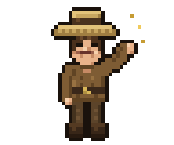<br>`hi` | 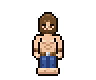<br>`idle` | 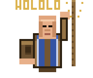<br>`think` | 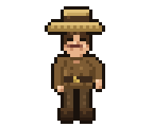<br>`talk` | 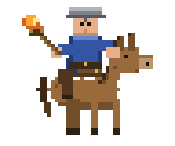<br>`read` | 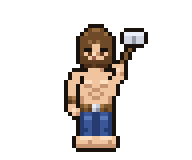<br>`write` |
| 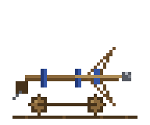<br>`tool` | 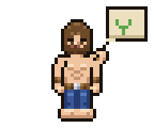<br>`ask` | 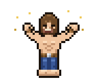<br>`success` | 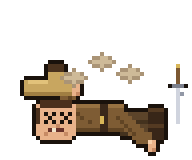<br>`failure` | 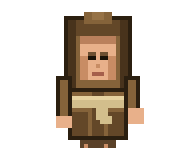<br>`compact` | 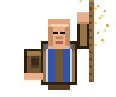<br>`delegate` |
| 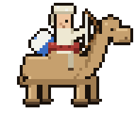<br>`explore` | 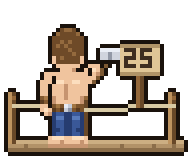<br>`build` | 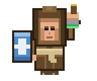<br>`verify` | 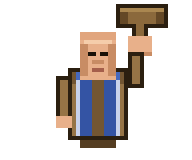<br>`judge` | 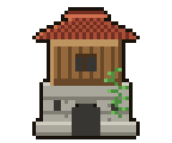<br>`review` | 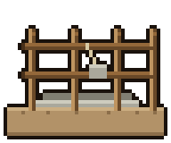<br>`jira` |
| 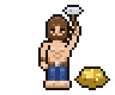<br>`jobs` | 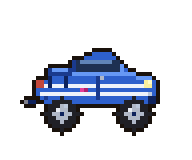<br>`yolo` | 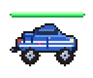<br>`super-yolo` | 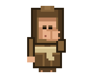<br>`remember` | 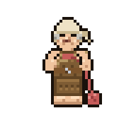<br>`grandma` | 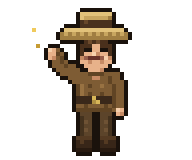<br>`bye` |

Las 24 celdas de arriba, contadas en palabras: qué personaje y acción de AoE
las dibuja y a qué momento del agente corresponde cada una (fuente:
[`docs/MAPA-ESCENAS.md`](docs/MAPA-ESCENAS.md); el sonido de cada momento está
en [Sonido ↔ Sprite](#sonido--sprite)).

| Estado | Qué se ve | Momento del agente |
|---|---|---|
| `hi` | Aldeano saludando con la mano en alto | Sesión arranca |
| `idle` | Aldeano parado junto a la granja | Esperando input |
| `think` | Sacerdote con mano en la barbilla, polvillo de fe | El modelo razona |
| `talk` | Aldeano respondiendo | El modelo responde |
| `read` | Caballería exploradora con antorcha | Lee código/memoria |
| `write` | Aldeano construyendo con andamio | Edita código |
| `tool` | Ariete golpeando | Ejecuta otras herramientas |
| `ask` | Aldeano con globo Y/N | Pregunta sí/no en pantalla |
| `success` | Sacerdote con unidad convertida de rodillas | Terminó bien |
| `failure` | Aldeano caído, polvo, espada clavada | Algo falló |
| `compact` | Monje achicándose, túnica intacta | Compactación de contexto |
| `delegate` | Monje repartiendo aldeanos a tareas | Subagentes genéricos |
| `explore` | Caballería con linterna, huellas | Subagente explorador |
| `build` | Herrera soldando el ariete | Subagente implementa |
| `verify` | Guardián con escudo y sello verde | Subagente verifica |
| `judge` | Monje con mazo, sentencia | Subagente juzga |
| `review` | Monje con pluma roja y pergamino | Subagente revisa |
| `jira` | Cohete de madera desde el castillo | Subagente Jira |
| `jobs` | Aldeano tomando mate junto a la barra | Jobs en background |
| `yolo` | Aldeano con vincha YOLO y cohete | Modo YOLO |
| `super-yolo` | Aldeano YOLO con sol | Modo Super YOLO |
| `remember` | Monje susurrando al oído del elefante | Guarda memoria en Engram |
| `grandma` | Aldeana tejiendo junto a la granja | Idle largo (30s) |
| `bye` | Aldeano sacándose el sombrero | Despedida |

Frame representativo por estado (el resto de la animación queda en la
carpeta del estado):

- `idle` → `idle.png`, el único estado obligatorio.
- `think` → `think_04.png`, el frame que dice WOLOLO.
- `talk` → `talk_mid.png`, la boca media de las cuatro variantes con peso.
- resto → `<estado>_01.png`.

Los PNG los genera [`scripts/scenes_gallery.py`](scripts/scenes_gallery.py)
(ver [Generadores](#generadores)); `--check` verifica que los 24 estén al
día sin escribir nada.

### Frames EXTRA con texto

Cada estado suma además un frame EXTRA con su **nombre** en dorado
(`read_03` dice READ, `jobs_03` dice JOBS, etc.), para que cada secuencia
diga qué está haciendo sin quitar arte.

Tres frames llevan gritos célebres y son **EXTRA**: se suman a la animación
del estado, no reemplazan el arte base.

| Estado | Frame | Texto |
|---|---|---|
| `think` | `think_04.png` | WOLOLO |
| `failure` | `failure_03.png` | ROGAN? |
| `hi` | `hi_03.png` | HELLO. |
| `yolo` | `yolo_03.png` | YOLO |
| `super-yolo` | `super-yolo_03.png` | SUPER YOLO |
| 17 estados | `<estado>_0N.png` | nombre del estado (READ, JOBS, …) |

El arte base de esos estados sigue siendo `think_01`/`think_02`,
`failure_01`/`failure_02` y `hi_01`/`hi_02`. La galería usa `think_04`
justamente porque el WOLOLO es el frame que mejor cuenta la conversión en
curso; `failure_03` y `hi_03` no se usan como representativos.

**Roadmap — frases célebres como frames EXTRA**: sumar taunts de AoE II
(`startthegamealready`, el «¿Rogan?» y los clásicos del 11 al 30) como frames
de texto adicionales en los estados donde ya hay arte, sin tocar las poses
base.

## Roadmap

1. **Ahora — sets con movimiento**: `aoe` (74 frames), `minecraft` y `cs16` (51 cada uno) ya animados; pulir `frameMs` y sumar taunts como frames extra.
2. **Sonido AoE**: la selección v2 está en `sounds/aoe/` pero todavía no está
   aplicada en la config viva de Gentle Shell (`notifications.json`); aplicarla
   con backup es un paso aparte, ver `docs/BETA.md`.
3. **Sprites StarCraft y LoL**: listos, 50 frames cada uno, generados por `gen_starcraft.py` y `gen_lol.py`.
4. **Minecraft**: sprites listos; falta mapa de escenas propio y probar el pack en vivo.
5. Licencia y remoto: ver checklist en `docs/BETA.md`. Incluye decidir qué
   pasa con los mp3 sin licencia verificada de StarCraft y LoL.

## Estructura

```
gentle-emote-arcade/
├── emotes/
│   ├── aoe/                 # set beta: 24 estados
│   │   ├── emotes.json      # timing: cycle, frameMs, pesos de talk
│   │   ├── ascii.yaml       # fallback ASCII (terminales sin imágenes)
│   │   ├── idle/            # único estado obligatorio: idle.png + idle_blink.png
│   │   ├── hi/              # hi_01.png + hi_02.png
│   │   ├── think/           # think_01.png + think_02.png
│   │   └── <estado>/        # una carpeta por escena, frames ordenados por nombre
│   ├── aoe-yolo/            # gemelo generado de aoe
│   ├── starcraft/ …         # sets en desarrollo (solo emotes.json)
│   └── cs16/
├── sounds/                  # un pack por juego: audios + seleccion.json
│   ├── aoe/                 # 13 wav + seleccion.json (14 eventos)
│   ├── minecraft/           # 13 mp3 + seleccion.json
│   ├── cs16/                # 12 wav + seleccion.json
│   ├── starcraft/           # 14 mp3 curados de datas + seleccion.json
│   └── lol/                 # 14 mp3 curados de datas + seleccion.json
├── docs/                    # BETA.md y mapas de escenas por juego
│   └── scenes/              # galería ×4 (192×160) de las 24 escenas, solo README
├── scripts/
│   ├── sprites/             # generadores de PNG por código
│   ├── scenes_gallery.py    # galería ×4: emotes/aoe/ → docs/scenes/
│   └── select_game.sh       # cambia sprites + sonidos al juego elegido
└── antigravity-pack/        # brief de arte: LEEME, TANDA, FUENTES y refs
```

Fuera del repo, pero en disco (`.gitignore`): `datas/<juego>/` con los mp3
crudos de trabajo, `previews/` con los previews ×8 y recortes, y `lab/` +
`test/` del workspace. Ver [`docs/BETA.md`](docs/BETA.md).

## Formato de frames

- PNG 48×40, 8-bit RGBA, sin interlace, fondo transparente (alfa real).
- Una carpeta por estado; los frames se ordenan alfabéticamente (`_01`, `_02`, …).
- 2 poses por estado (3 solo si es caminar o golpear).
- `idle` es el único estado obligatorio; un estado sin frames simplemente no
  se anima, así que se puede empezar por `idle` e ir sumando escenas.
- Pixel art nítido: sin blur, sin sombra externa, sin GIF, sin sprite-sheet,
  sin JPG en la entrega.

## Sonidos

`emotes.json` define solo el timing de los sprites; los sonidos van por otro
canal. Cada juego tiene su pack en `sounds/<juego>/`: los audios con nombres
cortos y un `seleccion.json` portable (schema
`gentle-emote-arcade.sounds/v1`) que mapea los 14 eventos a un nombre sin
extensión. `scripts/select_game.sh <juego>` cambia sprites y sonidos juntos.

### Packs de sonido

| Juego | Carpeta | Audio | Estado del audio | Sprites |
|---|---|---|---|---|
| Age of Empires II | `sounds/aoe/` | 13 wav (2,9 MB) | **completo**: 14 eventos, selección v2 | **beta**: 24 escenas |
| Minecraft | `sounds/minecraft/` | 13 mp3 (568 KB) | **descargado**: 14 eventos, sin probar en vivo | a sumar |
| Counter-Strike 1.6 | `sounds/cs16/` | 12 wav (405 KB) | **descargado**: 14 eventos, sin probar en vivo | en desarrollo (solo `emotes.json`) |
| StarCraft | `sounds/starcraft/` | 14 mp3 (408 KB) | **curado de `datas/starcraft/`**: un archivo por evento | en desarrollo (solo `emotes.json`) |
| League of Legends | `sounds/lol/` | 14 mp3 (583 KB) | **curado de `datas/lol/`**: un archivo por evento | en desarrollo (solo `emotes.json`) |

**Aviso de licencia**: los mp3 de `sounds/starcraft/` y `sounds/lol/` son
copias curadas de `datas/`, elegidas por nombre entre hallazgos de MyInstants
**sin licencia verificada**. Sirven para pruebas locales; no hay permiso
confirmado para redistribuirlos. Sus `seleccion.json` son portables, pero los
audios heredan esa duda: antes de publicar hay que decidir si se quitan o se
reemplazan por material con permiso (ver `docs/BETA.md`).

La selección AoE publicada, en detalle:

- **13 wav únicos** (2,9 MB) para **14 eventos**: `aldeanospawn` se usa dos
  veces (`session.started` y `subagent.completed`), así que no hay duplicados
  de archivo.
- `sounds/aoe/seleccion.json` guarda el mapeo `evento → archivo` en `choices`
  (portable: solo nombres sin extensión, relativos a `soundsDir`).

El mapa evento → sonido está en [Sonido ↔ Sprite](#sonido--sprite).

Para usar los sonidos en otra máquina alcanza con copiar `sounds/<juego>/` y
aplicar su `seleccion.json` (portable, solo nombres) a la config de
notificaciones de Gentle Shell
(`~/.gentle-shell/config/gentle-ai/notifications.json`).
`scripts/select_game.sh <juego>` hace backup y escribe las rutas `file:`
resolviendo la carpeta del pack.
**Hoy esa config todavía no recibió la selección AoE**: sigue apuntando a los
archivos de `waw/` (v1). Aplicarla es un paso aparte, con backup — ver
[`docs/BETA.md`](docs/BETA.md).

Los mp3 crudos de los que salieron los packs viven en `datas/<juego>/` (20 por
juego, 60 en total) y no se publican: cambian con cada tanda. Lo que viaja en el
árbol es la copia corta de `sounds/<juego>/` (con la duda de licencia de
arriba), sin los nombres de origen.

## Sonido ↔ Sprite

Cada serie de eventos de Gentle Shell dispara su propio sonido —`session.*`,
`agent.*`, `subagent.*`, `context.*`— y el sprite de esa misma escena lo
acompaña: imagen y audio cuentan el mismo momento. El mapa vigente sale de
`sounds/aoe/seleccion.json` (`choices`), 14 eventos sobre 13 wav:

| Evento | Sonido |
|---|---|
| `session.started` | `aldeanospawn` |
| `agent.started` | `priestconversion` |
| `agent.completed` | `priestconverted` |
| `agent.failed` | `rogan` |
| `agent.cancelled` | `malesounddeath5` |
| `agent.attention` | `attack` |
| `subagent.queued` | `farmexhausted` |
| `subagent.running` | `wololo` |
| `subagent.waiting` | `interface-population-limit` |
| `subagent.completed` | `aldeanospawn` |
| `subagent.failed` | `generic-male-death3` |
| `subagent.cancelled` | `generic-female-death3` |
| `subagent.timed_out` | `generic-siege-weapon-death` |
| `context.high` | `interface-town-bell1` |

- La única repetición es `aldeanospawn`: abre la sesión (`session.started`)
  y cierra un subagente (`subagent.completed`), así que no hay wav duplicado.
- `session.shutdown` es inerte: nunca suena.
- El porqué de cada elección y la escena (sprite) asociada están en
  [`docs/MAPA-ESCENAS.md`](docs/MAPA-ESCENAS.md).
- Los frames EXTRA de la [galería](#galería) son la contracara visual: WOLOLO
  en `think` cuando el monje convierte, ROGAN? en `failure`, HELLO. en `hi`.

## Instalación

1. Copiar `emotes/` a
   `~/.gentle-shell/agent/extensions/gentle-emote/emotes/` (global) o a
   `<proyecto>/.pi/extensions/gentle-emote/emotes/` (por proyecto).
2. Elegir el set en `config.json` del plugin:

   ```json
   { "emotes": [{ "model": "*", "emote-set": "aoe" }] }
   ```

   Cambiá `"aoe"` por `"aoe-yolo"`, `"starcraft"`, `"lol"` o `"cs16"` según el set.
3. `/reload` y `/emote demo` para ver las escenas.
4. Audio (opcional): copiar `sounds/aoe/` a una carpeta estable, apuntar ahí las
   rutas `file:` de `seleccion.json` y aplicar el mapa a la config de
   notificaciones de Gentle Shell.

## Generadores

Los frames salen de `scripts/sprites/*.py` y la galería del README de
`scripts/scenes_gallery.py`, sin dependencias (solo stdlib: `zlib`, `struct`,
`os`). Los de `sprites/` escriben rutas relativas al workspace, así que hay
que correrlos desde la raíz del proyecto AoE:

```bash
cd <workspace>/AoE
python3 gentle-emote-arcade/scripts/sprites/gen_aoe_final.py   # set aoe
python3 gentle-emote-arcade/scripts/sprites/gen_aoe_yolo.py    # escribe /tmp/gen_yolo2.py
python3 /tmp/gen_yolo2.py                                      # recién ahí regenera aoe-yolo
python3 gentle-emote-arcade/scripts/scenes_gallery.py          # galería ×4 -> docs/scenes/
python3 gentle-emote-arcade/scripts/scenes_gallery.py --check  # verifica la galería, sin escribir
```

`scenes_gallery.py` es el único que no toca `emotes/`: lee el frame
representativo de cada estado y escribe `docs/scenes/<estado>.png` en
192×160. Se puede correr desde cualquier carpeta, y con `--emotes-dir` /
`--out-dir` apunta a otro set y a otra salida. `--check` sale con 1 si falta
un PNG, si sobra uno o si quedó viejo respecto de los frames actuales.

Advertencias verificadas en el código actual:

- `gen_aoe_final.py` genera **una** pose por estado (`<estado>.png`): pisa
  todos los estados de una sola pose (incluidos `tool` y `success`) y también
  `idle`, `talk`, `yolo` y `super-yolo`; además agrega `hi.png` / `think.png`
  de un frame al lado de las poses nuevas `_01`/`_02`. No conviene correrlo
  hasta completar la tanda de 2 poses por estado, porque borra trabajo ya
  entregado.
- `gen_aoe_yolo.py` no ejecuta el generador parcheado: solo lo deja en
  `/tmp/gen_yolo2.py`, que hay que correr aparte (ver
  [`emotes/aoe-yolo/README.md`](emotes/aoe-yolo/README.md)).
- `gen_idle_aoe.py` y `gen_all_aoe.py` son versiones viejas: la primera apunta
  a una ruta que ya no existe (`gentle-emote-aoe/`, con guion) y la segunda
  genera una pose por estado. Quedan como historial.

## Documentación

- [`docs/BETA.md`](docs/BETA.md) — estado por set, verificación de frames y
  audio, qué quedó fuera del repo y checklist para publicar.
- [`docs/MAPA-ESCENAS.md`](docs/MAPA-ESCENAS.md) — las 24 escenas × sonido ×
  sprite AoE.
- `docs/MAPA-ESCENAS-{starcraft,lol,cs16}.md` — idem por juego (en desarrollo).
- [`docs/scenes/`](docs/scenes/) — galería ×4 (192×160) de las 24 escenas,
  solo para el README; la genera `scripts/scenes_gallery.py`.
- [`antigravity-pack/`](antigravity-pack/) — brief de arte: `LEEME.md`,
  `TANDA.md` (las 24 poses pedidas), `FUENTES.md` y `refs/`.

## Créditos y aviso

- Plugin original: [cgxeiji/pi-emote](https://github.com/cgxeiji/pi-emote) vía
  [efolchmontiel/gentle-emote](https://github.com/efolchmontiel/gentle-emote).
- Frames: pixel art generado por `scripts/sprites/*.py` (48×40 RGBA).
- Galería del README: `scripts/scenes_gallery.py` (×4 desde esos frames).
- Audios: efectos de sonido de Age of Empires II, StarCraft, League of Legends,
  Counter-Strike 1.6 y Minecraft, recopilados de MyInstants. Los mp3 de
  StarCraft y LoL salen de `datas/` y no tienen licencia verificada: solo
  pruebas locales.
- Personajes, nombres y audios de los juegos pertenecen a sus respectivos
  dueños (Microsoft, Blizzard, Riot Games, Valve, Mojang). Proyecto personal y
  experimental, sin relación con ellos.
- Licencia MIT (`LICENSE`, 2026): cubre código, sprites generados, galería y mapas. Los audios y marcas de los juegos **no** entran en esa licencia (ver aviso arriba).
- Los JPG crudos de referencia, los mp3 de trabajo, los previews y los logs no
  se versionan (ver [`.gitignore`](.gitignore)).

---
Powered by Gentle Shell
