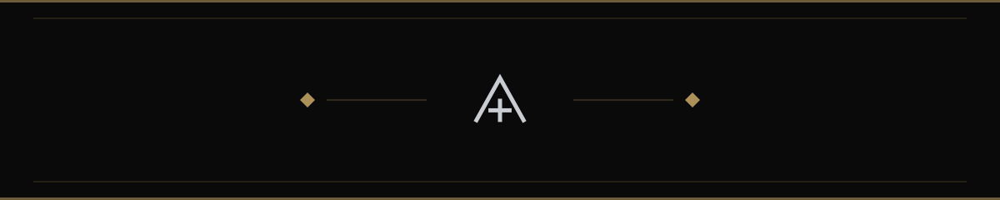
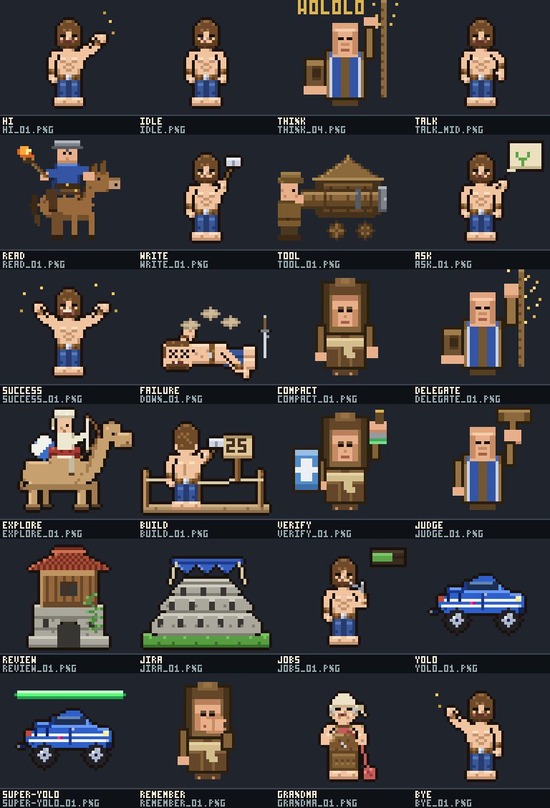

  

  

<h1 align="center">gentle-emote-arcade</h1>

  
  

Una capa auditiva sobre Gentle Shell: cada cosa que hace el agente tiene su
sonido, y cada proyecto tiene su juego. Así sabés en qué proyecto estás y en
qué anda sin mirar la pantalla.

Los mismos 24 estados mueven el sprite y el audio: lo que ves y lo que oís
salen de la misma tabla, así que no hay dos verdades que se contradigan.

## Gracias

Esto existe porque otros lo hicieron antes y lo dejaron abierto.

- [**efolchmontiel/gentle-emote**](https://github.com/efolchmontiel/gentle-emote)
  (npm `gentle-emote@0.1.4`): el avatar, las 24 escenas y el motor de eventos
  sobre el que está armado todo lo de acá. MIT.
- [**cgxeiji/pi-emote**](https://github.com/cgxeiji/pi-emote), de
  [Eiji Onchi](https://github.com/cgxeiji): el linaje de ese paquete y el arte de
  `gentleman` / `gentleman-yolo`, que viaja sin retocar. MIT.
- **Gentle Shell**, el motor: sus notificaciones son el punto de enganche y su
  config la que se escribe, siempre con backup al lado. Al pie, una sola vez.
- [**scrapysound**](https://github.com/cantabriarudolf/scrapysound): de ahí
  salieron las frases del pack `gentle` y el mapeo evento → frase.

## Créditos y linaje

Este repo **no es un fork de GitHub**: nació como repo independiente, así que
GitHub no muestra el cartel «forked from», y ese cartel no se puede agregar
después a un repo que ya existe. El linaje se declara acá y en los archivos que
importamos, que es lo que la licencia MIT de origen pide: conservar el aviso de
copyright.

El detalle pieza por pieza:

| Pieza | Origen | Autoría | Licencia |
|---|---|---|---|
| Código del avatar | [`gentle-emote`](https://github.com/efolchmontiel/gentle-emote) (npm `gentle-emote@0.1.4`) | [efolchmontiel](https://github.com/efolchmontiel) | MIT |
| Linaje de ese paquete | [`pi-emote`](https://github.com/cgxeiji/pi-emote) | Eiji Onchi | MIT |
| Arte de `gentle` y `gentle-yolo` | sets `gentleman` / `gentleman-yolo` del mismo paquete, sin retocar | Eiji Onchi + efolchmontiel | MIT (copia en [`emotes/gentle/LICENSE`](emotes/gentle/LICENSE)) |
| Sprites de los juegos | generadores de `scripts/sprites/` | este repo | MIT |
| Sonidos de los juegos | packs de cada juego (ver aviso de licencia) | sus dueños | — |

Si en algún momento querés devolver algo aguas arriba —el menú de dos pasos, el
generador del arte— ahí sí conviene un fork real de
`efolchmontiel/gentle-emote`: el fork existe para mandar PRs, no para publicar.

### Sonidos de `gentle`

El pack oculto `gentle` suena con **14 frases de Gentleman Programming**, una por
evento: se extrajeron del video con
[scrapysound](https://github.com/cantabriarudolf/scrapysound), el mapeo
evento → frase vive en `scrapysound/scrapysounds_task/audio_event_mapping.md` y
el pack se regenera con `python3 scripts/make_gentle_sounds.py` (mp3 → WAV PCM
mono). El detalle, con el clip elegido por evento, está en
[`sounds/gentle/README.md`](sounds/gentle/README.md).

**Aviso de licencia**: la voz es del streamer y no hay permiso verificado para
redistribuirla. Igual que los packs de `starcraft` y `lol`, está pensado para
uso local: ver *Licencia* al final.

## Para quién

Para quienes trabajan apoyándose en estímulos auditivos:

- Sabés qué hace el agente **sin mirar la pantalla**: cada evento tiene su sonido.
- Cada proyecto puede sonar con **un juego distinto**, y distinguís cuál pide atención.
- Tres niveles de invasividad: `todo` (14 eventos), `esencial` (12, sin el ruido
  de `queued`/`running`) y `guardia` (6 que piden tu mano: `attention`, `failed`,
  `waiting`, `timed_out` de hijos, `context.high`).
- Imagen y audio cuentan lo mismo: la escena del sprite y su sonido salen de
  la misma tabla de 24 estados.
- Y para quien tiene varias sesiones abiertas y no puede cambiar de ventana
  cada vez que quiere saber dónde lo están esperando.

## Sets

| Set | Juego | Frames |
|---|---|---|
| `aoe` | Age of Empires II | 75 PNG, 24 escenas |
| `aoe-yolo` | AoE II, gemelo YOLO | 75 PNG |
| `cs16` / `cs16-yolo` | Counter-Strike 1.6 | 51 PNG c/u |
| `starcraft` / `starcraft-yolo` | StarCraft | 50 PNG c/u |
| `lol` / `lol-yolo` | League of Legends | 50 PNG c/u |
| `minecraft` | Minecraft | 51 PNG |
| `gentle` | avatar original del fork | 76 PNG, 24 escenas |
| `gentle-yolo` | avatar original, gemelo YOLO | 76 PNG, 24 escenas |

Elenco AoE: aldeano musculoso, monje, camello explorador, cobra azul
(`yolo` sin barra, `super-yolo` con barra verde), coliseo, torre, obra en
3 etapas y minero de oro.

## Galería (arte actual)

Hoja rotulada del set `aoe`, con el nombre de la acción por imagen:

Detalle 24 estados × 9 sets: [`docs/CATALOGO.md`](docs/CATALOGO.md).
Serie completa por juego: `python3 scripts/scenes_demo.py` →
`http://127.0.0.1:8785` (en «Serie completa» podés subir la foto de
referencia de cada estado; queda en `docs/refs/`).

## Sonido

Un pack por juego en `sounds/<juego>/` (`seleccion.json` portable,
schema `gentle-emote-arcade.sounds/v1`, 14 eventos). Extra: `misc`
(un evento de cada juego, reutilizando `pack/tallo` de los otros packs: no
tiene audio propio) y `gentle` oculto (14 frases del streamer + activación «abuela», ver
*sounds/gentle/README.md*; sus escenas también son propias, ver *Créditos y
linaje*). `scripts/select_game.sh <juego>` elige sprites y sonidos para el
proyecto actual (el audio global lo aplica el hook `session_start` al abrir
sesión, ver *Elegir juego*).
  El easter egg `abuela` (alias de `gentle`) activa el pack oculto con la frase de
  «abuela» (`abuela-1`), sus 14 frases y sus propias escenas. Y al abrir una
  **sesión nueva** (`/new`, cartel «✓ New session started») suena la frase
  `esto-es-una-locura` — ese cartel no lo cubre `session.started`, que sólo suena
  al arrancar el proceso. El `coin` quedó sólo
  como fallback del código.

## Elegir juego

Dos caminos, los dos eligen sprites y sonidos por proyecto:

- **Desde Gentle Shell**: `/emote:juego` abre el menú interactivo de dos pasos:
  1. **juego** (`aoe`, `cs16`, `starcraft`, `lol`, `minecraft`, `misc`, `gentle`);
  2. **set de notificaciones auditivas**:

  | Set | Nivel | Eventos | Qué suena |
  |---|---|---|---|
  | `a` | `todo` | 14 | todo lo que pasa, incluidos `queued` y `running` |
  | `b` | `esencial` | 12 | lo mismo sin el ruido de `queued`/`running` |
  | `c` | `guardia` | 6 | sólo lo que pide tu mano (`attention`, `failed`, `waiting`, hijos `timed_out`, `context.high`) |

  Al aplicar **suena el pack nuevo**: el `session.started` de ese juego (en el
  set `c`, que lo silencia, suena el `agent.attention`), así sabés con el oído
  que el cambio entró. En `gentle`/`abuela` suena la frase de «abuela».

  El set se pregunta **siempre**, aunque el juego vaya por argumento: sólo
  `--invasividad a|b|c` lo saltea. Al terminar, el comando **recarga la sesión
  solo** (`ctx.reload()`), sin `/reload` manual. También se puede ir directo:
  `/emote:juego <juego> [set]`, con el nombre, un prefijo único o el número de
  la lista; y `--dry-run` muestra el plan sin escribir nada (ahí el set guardado
  del proyecto es el default).
- **Desde la terminal**: `scripts/select_game.sh <juego> [--proyecto RUTA]
  [--invasividad a|b|c]`, con las mismas banderas (`--help` para el detalle).

Los dos escriben **sólo en el proyecto destino**: el `emote-set` en
`<proyecto>/.pi/extensions/gentle-emote/config.json` (lo crean si falta, con
backup al lado), el pack de sprites en
`<proyecto>/.pi/extensions/gentle-emote/emotes/<set>`, y juego + set elegidos
en el mapa junto al arcade (`.pi/extensions/game-select/projects.json`, así el
segundo arranque ya sabe qué set usabas). Nunca tocan
`~/.gentle-shell/config/gentle-ai/notifications.json`: el audio de Gentle Shell
es un único archivo global para todas las sesiones, y lo aplica el hook
`session_start` de la extensión al abrir sesión en el proyecto, con backup
fechado al lado; la primera vez deja `notifications.baseline.json` con el audio
previo al primer pack, y un proyecto sin entrada vuelve a ese baseline. Es
idempotente: si la config ya está como debe, no escribe ni respalda. Los tests
de la extensión cubren el menú de dos pasos, los tres sets y el hook:
`node --test tests/game-select.test.ts`.

## Instalación

1. Instalar `extensions/game-select/index.ts` **global**, no por proyecto, para
   que el menú y el hook existan en cualquier sesión:
   `ln -sf "$PWD/extensions/game-select/index.ts" ~/.gentle-shell/agent/extensions/game-select/index.ts`.
   El `projects.json` sigue viviendo junto al arcade (`Proyectos/AoE/.pi/extensions/game-select/`),
   así cada proyecto recuerda su juego aunque arranques desde otra carpeta.
2. Elegir juego en cada proyecto: `scripts/select_game.sh <juego>` (o
   `/emote:juego`). El selector crea
   `<proyecto>/.pi/extensions/gentle-emote/config.json` con el `emote-set`
   (`{ "emotes": [{ "model": "*", "emote-set": "aoe" }] }`), copia el pack de
   sprites a `<proyecto>/.pi/extensions/gentle-emote/emotes/<set>` y guarda la
   entrada en el `projects.json`. No hace falta copiar `emotes/` a mano: el dir
   global del avatar es biblioteca compartida, no selección.
3. El audio global lo aplica el hook `session_start` al abrir sesión, con
   backup fechado y `notifications.baseline.json` como punto de vuelta. Para
   forzar un pack a mano queda `scripts/apply_sounds.sh`.
4. `/reload` y `/emote demo`.

Los tests de la extensión corren con el Node que trae Gentle Shell:
`node --test tests/game-select.test.ts` (trabajan en un sandbox temporal, no
tocan la config real).

## Logs acotados

El paquete upstream escribe `debug.log` en cada frame del avatar y no rota
nunca: con `debug: true` llegó a 558 MB en `~/.gentle-shell/agent/npm/node_modules/gentle-emote/`.
Este repo lo mantiene acotado por tres lados, y no parchea el paquete npm
instalado:

- `debug: false` en los `config.json` (también es el default del paquete): no
escribe nada mientras esté apagado.
- la traza `/tmp/game-select.log` se trunca sola a 64 KB.
- `scripts/check_install.sh` avisa si el log creció o si queda algún archivo
ajeno (de root) en `.pi/`, y marca DRIFT si el paquete npm quedó parcheado a
mano (`MAX_LOG_BYTES` en `src/log.ts`): en ese caso `pi update` lo devuelve a
upstream. También verifica que los packs de sprites del proyecto coincidan con
el repo y que los `file:` de la config viva apunten a archivos que existen.

## Cómo reparte el canal

Gentle Shell no acumula sonidos: tiene **un solo slot pendiente**. Cada evento
trae prioridad fija (`failed` y `timed_out` = 3; `attention` y `context.high` = 2;
los `completed` = 1; el resto = 0), sólo suena lo que puede empezar dentro de los
**2 segundos** siguientes a cuando ocurrió, y entre un sonido y el próximo pasan
al menos **1000 ms**. Si dos eventos caen juntos, sobrevive el de mayor prioridad
y el otro se descarta sin avisar.

Consecuencia práctica: el set `a` no significa «suena todo», significa «todo
compite por el canal». Con `guardia` (set `c`) suenan sólo los seis que piden tu
mano, y por eso es el más confiable para trabajar.

## Licencia

**MIT** ([`LICENSE`](LICENSE)): usalo, cambialo, redistribuilo, vendelo, con una
sola condición — dejá el aviso de copyright. Es la misma licencia que los dos
proyectos de los que viene este repo.

| Capa | Qué incluye | Licencia |
|---|---|---|
| Código, arte propio y docs | `extensions/`, `scripts/`, `emotes/aoe`…`lol`, `docs/` | MIT |
| Avatar de `gentle` / `gentle-yolo` | `emotes/gentle`, `emotes/gentle-yolo` | MIT, de Eiji Onchi y efolchmontiel — su aviso viaja en el `LICENSE` de cada uno |
| Audio de los juegos | `sounds/` | Sin licencia verificada — ver el aviso de abajo |

Para contribuir: un PR con el generador que produce el arte (`scripts/sprites/`),
sin audios sin permiso y manteniendo 48×40 RGBA.

Los audios y las marcas de los juegos son de sus dueños: procedencia, dueño de
cada marca y alcance de la zona gris en [`docs/AVISO-AUDIO.md`](docs/AVISO-AUDIO.md).
Los packs de `starcraft` y `lol` no tienen
licencia verificada, y el de `gentle` usa la voz del streamer sin permiso
confirmado: la dirección del repo es distribuir el **generador**
(`scripts/make_gentle_sounds.py` más el mapeo evento → frase) y no los WAV como
parte de lo publicado.

No hay pedido comercial: la licencia permite vender sin pedir permiso. Lo que sí
pide la casa es que si mejorás algo, lo devuelvas.

---

  <strong>motor · Gentle Shell</strong> · MIT

