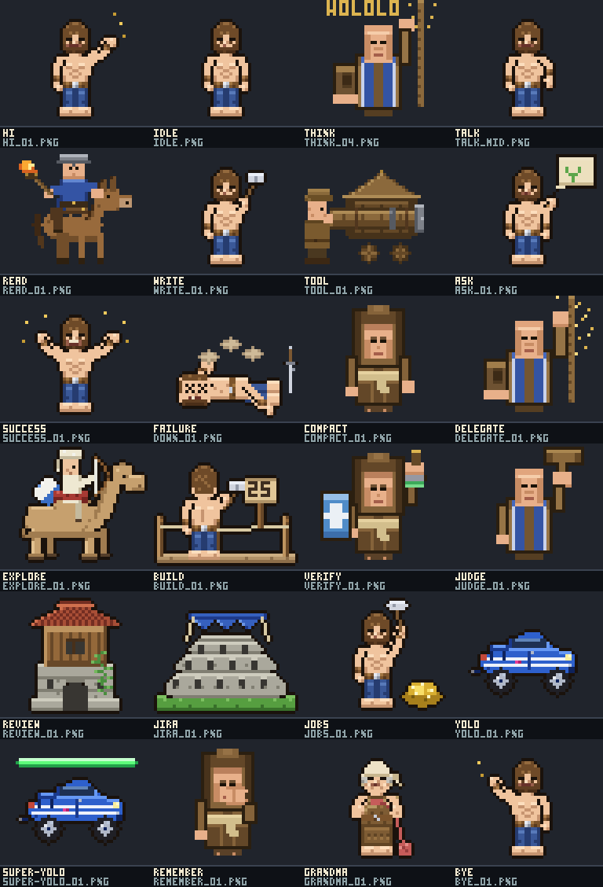

# gentle-emote-arcade

El avatar y los sonidos de Gentle Shell, con sprites de videojuegos: cada cosa
que hace el agente se ve y se escucha con el mismo juego.

Powered by Gentle Shell. Fork de
[efolchmontiel/gentle-emote](https://github.com/efolchmontiel/gentle-emote)
(vía [cgxeiji/pi-emote](https://github.com/cgxeiji/pi-emote)).

## Para quién

Para quienes trabajan apoyándose en estímulos auditivos:

- Sabés qué hace el agente **sin mirar la pantalla**: cada evento tiene su sonido.
- Cada proyecto puede sonar con **un juego distinto**, y distinguís cuál pide atención.
- Tres niveles de invasividad: `todo` (14 eventos), `esencial` (12, sin el ruido
  de `queued`/`running`) y `guardia` (6 que piden tu mano: `attention`, `failed`,
  `waiting`, `timed_out` de hijos, `context.high`).
- Imagen y audio cuentan lo mismo: la escena del sprite y su sonido salen de
  la misma tabla de 24 estados.

## Sets

| Set | Juego | Frames |
|---|---|---|
| `aoe` | Age of Empires II | 75 PNG, 24 escenas |
| `aoe-yolo` | AoE II, gemelo YOLO | 75 PNG |
| `cs16` / `cs16-yolo` | Counter-Strike 1.6 | 51 PNG c/u |
| `starcraft` / `starcraft-yolo` | StarCraft | 50 PNG c/u |
| `lol` / `lol-yolo` | League of Legends | 50 PNG c/u |
| `minecraft` | Minecraft | 51 PNG |

Elenco AoE: aldeano musculoso, monje, camello explorador, cobra azul
(`yolo` sin barra, `super-yolo` con barra verde), coliseo, torre, obra en
3 etapas y minero de oro.

## Galería (arte actual)

Hoja rotulada del set `aoe`, con el nombre de la acción por imagen:

Detalle 24 estados × 9 sets: [`docs/CATALOGO.md`](docs/CATALOGO.md).
Serie completa por juego: `python3 scripts/scenes_demo.py` →
`http://127.0.0.1:8785`.

## Sonido

Un pack por juego en `sounds/<juego>/` (`seleccion.json` portable,
schema `gentle-emote-arcade.sounds/v1`, 14 eventos). Extra: `misc`
(un evento de cada juego) y `gentle` oculto (pitidos builtin, 7/14).
`scripts/select_game.sh <juego>` cambia sprites y sonidos con backup.
El easter egg `abuela` activa el pack oculto con sonido de coin.

## Instalación

1. Copiar `emotes/` a `~/.gentle-shell/agent/extensions/gentle-emote/emotes/`
   (global) o a `<proyecto>/.pi/extensions/gentle-emote/emotes/`.
2. Elegir set en `config.json`: `{ "emotes": [{ "model": "*", "emote-set": "aoe" }] }`.
3. `/reload` y `/emote demo`.

## Licencia colaborativa

MIT vigente ([`LICENSE`](LICENSE)): código, sprites, galería y mapas se pueden
usar, modificar y redistribuir manteniendo el aviso. Para contribuir: un PR
con el generador que produce el arte (`scripts/sprites/`), sin audios sin
permiso y manteniendo 48×40 RGBA. Sin venta ni publicidad alrededor del repo.

Los audios y marcas de los juegos pertenecen a sus dueños (ver
[`docs/BETA.md`](docs/BETA.md)); los mp3 de StarCraft/LoL no tienen licencia
verificada: solo pruebas locales.

---
Powered by Gentle Shell
